# End-to-End Walkthrough

This guide runs the AI-First CRM from a clean start and walks through every feature. Each step lists the exact message to type and the expected result.

Time needed: about 15 minutes.

---

# 1. Start the Application

Requirements: Docker Desktop and a Groq API key ([Deployment Guide](../deployment/deployment.md)).

```powershell
git clone https://github.com/firrexguptaji/ai-first-crm-hcp.git
cd ai-first-crm-hcp

Copy-Item .env.example .env       # set GROQ_API_KEY in .env

docker compose down -v            # start from a clean database
docker compose up --build -d
docker compose ps                 # wait until all services are "healthy"
```

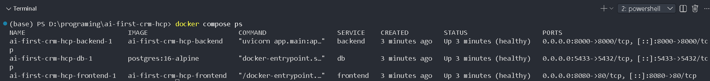

Open **http://localhost:8080**.

The database contains six demo Healthcare Professionals: Alice Brown, John Smith, Priya Sharma, Rahul Mehta, Emily Clark and David Lee.

---

# 2. The Interface

| Area | Purpose |
|------|---------|
| **AI Assistant** (right) | The only way to create and change data |
| **Interaction Details** (left) | Read-only; fills automatically from AI responses |

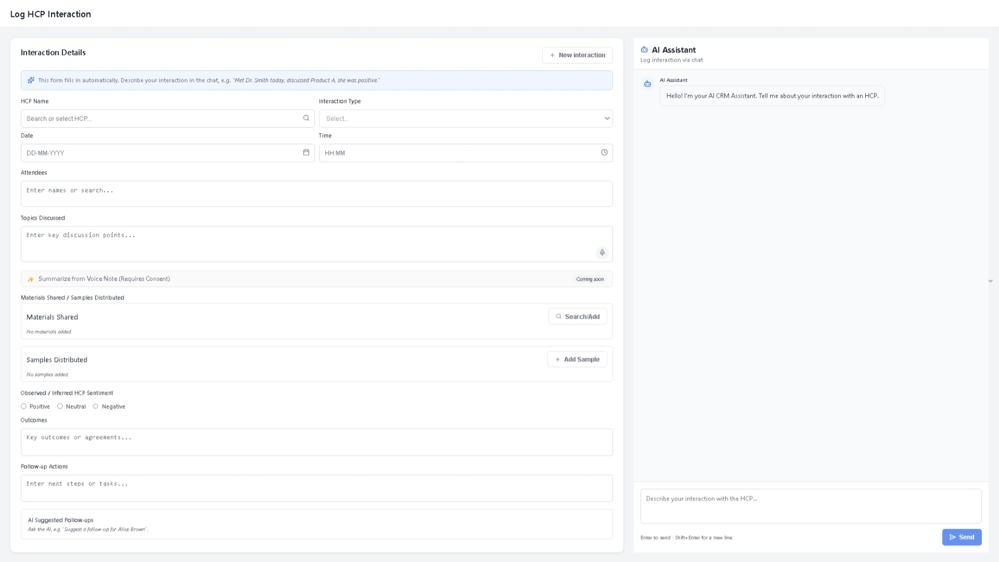

The blue hint explains that the form is filled by the chat. **New interaction** is disabled while the form is empty.

---

# 3. Log an Interaction

Type and press **Enter**:

```text
Met Alice Brown today at her clinic with Nurse Kelly. Discussed Product A, left two Product A starter packs. She agreed to trial it with 5 patients. I need to send her the Phase III data next week. She was positive.
```

Expected

- "Thinking…" indicator, then *Interaction logged successfully for Alice Brown.*
- Badge **Logged by AI**
- The form shows every field extracted by the AI:

| Field | Value |
|-------|-------|
| HCP Name | Alice Brown |
| Interaction Type | In Person |
| Date / Time | Today / current time |
| Attendees | Nurse Kelly |
| Topics Discussed | AI summary of the discussion |
| Materials Shared | Product A |
| Samples Distributed | Product A starter pack |
| Sentiment | Positive |
| Outcomes | Agreed to trial Product A with 5 patients |
| Follow-up Actions | Send Phase III data · Follow up on (next week) |

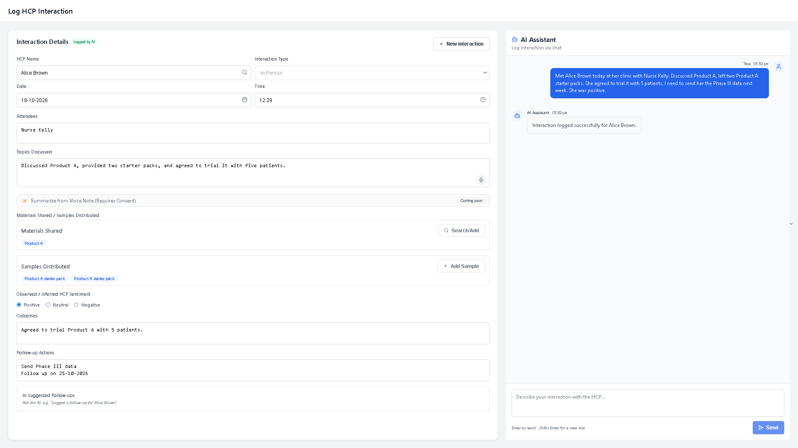

---

# 4. Edit the Interaction

The edit targets the interaction shown in the form, and only the fields you mention change.

```text
Add Dr. Patel as an attendee for Alice Brown
```

Expected: Attendees **Nurse Kelly, Dr. Patel**; badge **Updated by AI**; every other field unchanged.

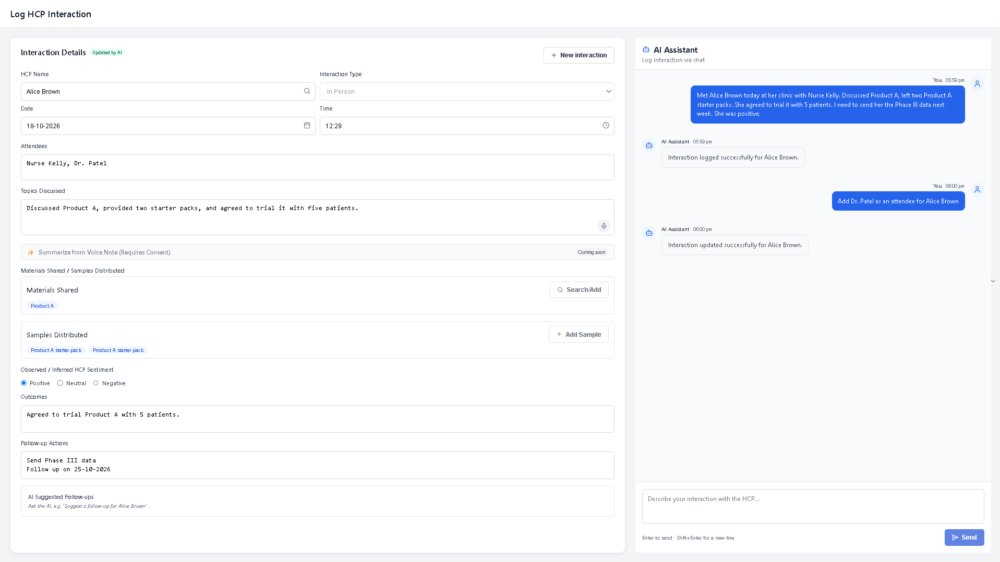

More edits to try

| Message | Result |
|---------|--------|
| `The meeting with Alice Brown was actually a phone call` | Interaction Type → Phone |
| `Remove Nurse Kelly from the attendees for Alice Brown` | Attendees → Dr. Patel |
| `Actually she was neutral` | Asks which HCP (no name given) |
| `Edit the outcome for Alice Brown` | *I couldn't tell what to change…* |

---

# 5. Safe Editing: Ambiguous Requests

1. Log a second interaction:

   ```text
   Called Alice Brown yesterday about Product B, she was neutral.
   ```

2. Click **New interaction** (clears the form).

3. Type:

   ```text
   Set the outcome for Alice Brown to agreed to trial
   ```

Expected: a **yellow** message listing Alice Brown's interactions and asking which one to update. **Nothing is changed.**

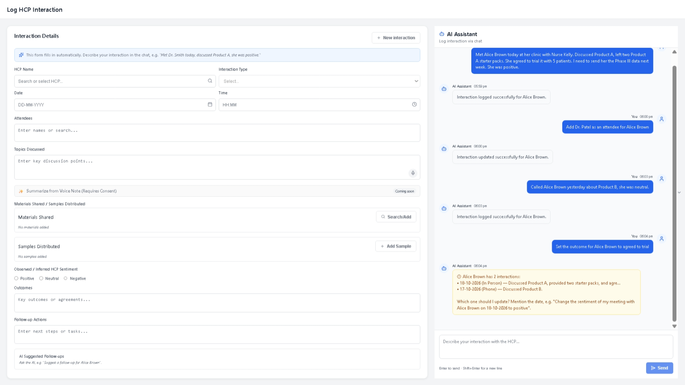

Then be explicit:

```text
Set the outcome of my last meeting with Alice Brown to agreed to trial
```

---

# 6. Interaction History

```text
When did I last meet Alice Brown?
```

Expected: the reply includes the count and the latest interaction (date, type, summary). The form shows the latest interaction with the badge **Latest from history**.

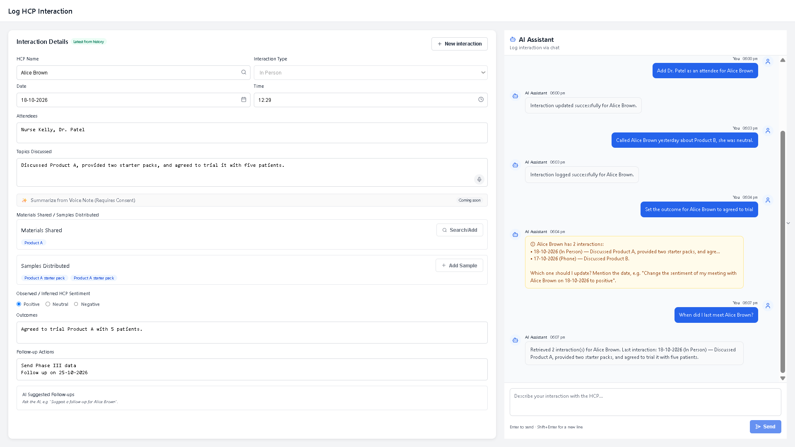

---

# 7. Search Healthcare Professionals

```text
Find cardiologists
```

Expected: *Found 2 Healthcare Professional(s).* (Alice Brown and Rahul Mehta). The form does not change.

---

# 8. Suggested Follow-up

```text
Suggest a follow-up for Alice Brown
```

Expected: an AI recommendation in the chat and under **AI Suggested Follow-ups** in the form.

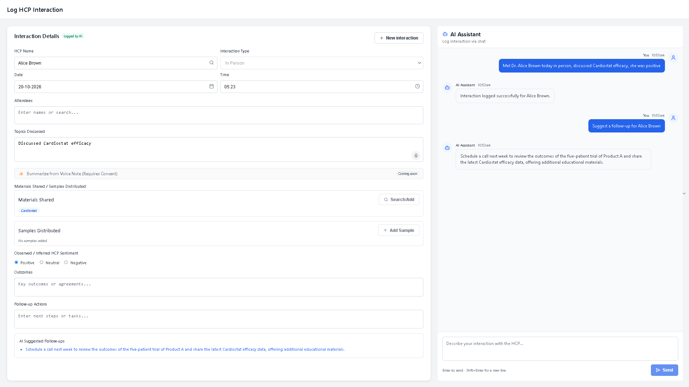

---

# 9. Unsupported Requests

```text
Hi
```

Expected: a **blue** reply listing what the assistant can do. Requests such as `Delete my last interaction with Alice Brown` or `What's the weather today?` get the same treatment. **Nothing is written to the database.**

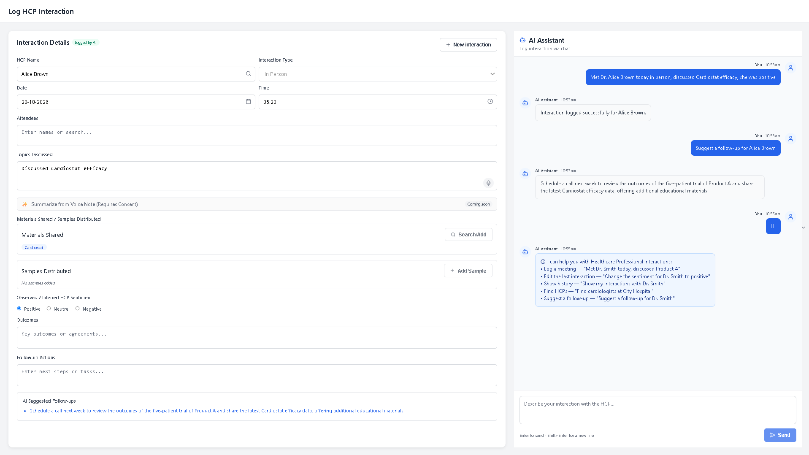

---

# 10. Error Handling and Retry

1. Stop the backend: `docker compose stop backend`
2. Send any message, e.g. `Find Alice Brown`

Expected: a **red** message *Can't reach the server…* with a **Retry** button.

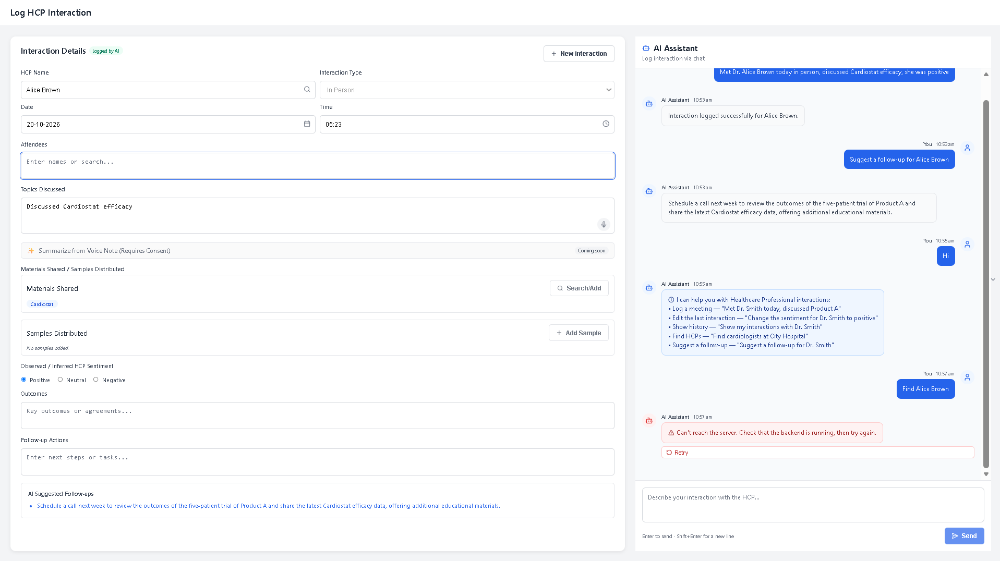

3. Start the backend: `docker compose start backend`
4. Wait about 10 seconds, then click **Retry**

Expected: the error disappears and the reply arrives.

---

# 11. Responsive Layout

Open DevTools (**F12**) → device toolbar (**Ctrl + Shift + M**) → **iPhone 12**.

Expected: one column, chat on top, form below; nothing cut off.

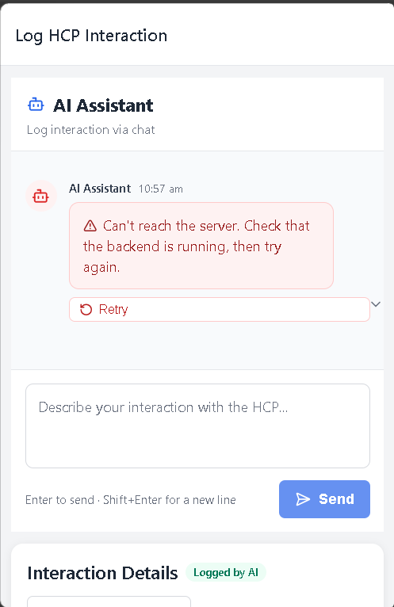

---

# 12. API

Open **http://localhost:8000/docs**. The AI workflow is `POST /chat`; HCPs and interactions also have REST endpoints.

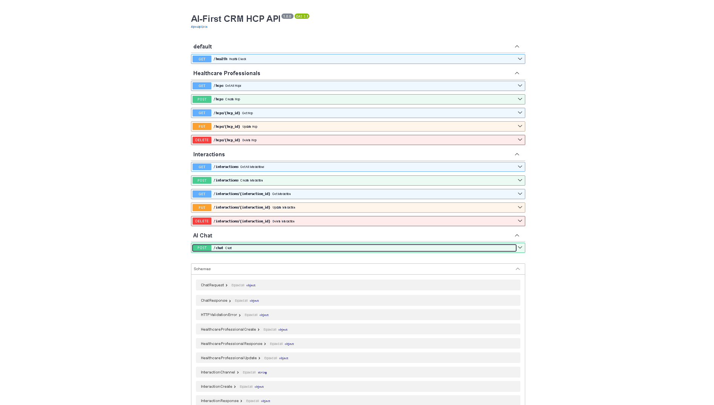

Example request:

```json
{
  "message": "Find Alice Brown"
}
```

---

# 13. Tests

```powershell
cd backend
pip install -r requirements-dev.txt
# backend/.env: TEST_DATABASE_URL pointing to a separate test database
pytest -v
```

Expected: `281 passed, 55 skipped`. Groq tests are skipped unless `RUN_LIVE_TESTS=1`.

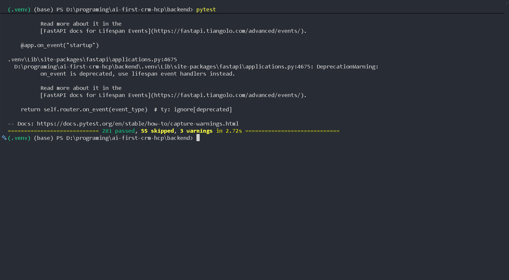

Optional live routing evaluation (47 messages):

```powershell
$env:RUN_LLM_EVAL="1"; pytest tests/test_routing_eval.py -v
```

---

# 14. Stop

```powershell
docker compose down        # keep data
docker compose down -v     # delete the database
```

---

# Feature Checklist

| Feature | Step |
|---------|------|
| AI logs interactions from natural language | 3 |
| All form fields filled by the AI | 3 |
| Edits change only the mentioned fields | 4 |
| Add / remove list values | 4 |
| Ambiguous edits ask instead of guessing | 5 |
| History answers "when did I last…" | 6 |
| HCP search | 7 |
| AI follow-up suggestions | 8 |
| Unsupported requests never write | 9 |
| Clear errors with retry | 10 |
| Responsive layout | 11 |
| REST API with Swagger | 12 |
| Automated tests on a separate database | 13 |

---

# Limitations

This is an assessment build without authentication. See [Security & Limitations](../security/security.md).

---

## Notes

- **Rate limits:** the Groq free tier limits requests per minute and per day. If replies fail with an error, wait a minute (or until the daily quota resets) and press **Retry**.
- **Times:** the backend container runs in UTC, so the interaction **Time** field can differ from your local chat timestamp (for example `12:29` vs `05:59 pm` IST).
